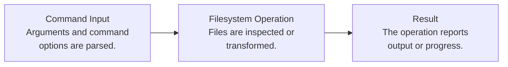

# FileOrganiser

A command-line file organization utility implemented with Node.js.

## Overview

The repository contains an implemented application or analysis project with code organized around its primary runtime, interface, data, or automation responsibilities.

## Key Features

- Node.js command execution or server runtime
- Modular source organization
- External I/O or API integration
- Scripted or interactive output

## Technology Stack

| Area | Technology |
|---|---|
| Platform | Node.js |
| Library / Framework / Tool | JavaScript |

## Architecture and Data Flow

| Stage | Responsibility |
|---|---|
| **Command Input** | Arguments and command options are parsed. |
| **Filesystem Operation** | Files are inspected or transformed. |
| **Result** | The operation reports output or progress. |

## Repository Structure

- `commands`
- `main.js`
- `package.json`

## Setup

1. Install Node.js and npm.
2. Run `npm install` from the repository root.
3. Start the project with the applicable script below.

## Usage

- `npm run test` — echo "Error: no test specified" && exit 1

## Configuration

Review `package.json` for available scripts and runtime dependencies. Add environment variables locally only when a feature requires external credentials or service configuration.

## Verification

- `npm run test` — echo "Error: no test specified" && exit 1
