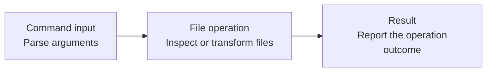

# FileOrganiser

**Portfolio project** · A Node.js command-line utility for organizing files through reusable commands.

## Overview

A Node.js command-line utility for organizing files through reusable commands.

## Technology Stack

- `Node.js`
- `JavaScript`

## How the Repository Works

| Stage | Responsibility |
|---|---|
| **Command input** | Parse arguments |
| **File operation** | Inspect or transform files |
| **Result** | Report the operation outcome |

## Concepts Covered

- JavaScript runtime
- Asynchronous I/O
- Modules and packages
- HTTP or CLI workflows
- External integrations

## Repository Map

- `commands`
- `main.js`
- `package.json`

## Recruiter Summary

This repository demonstrates practical implementation skills, repository organization, and an end-to-end understanding of the project workflow. It is suitable as a focused example of applied software or data work.

---

Documentation is concise and project-focused; source code was not modified.
